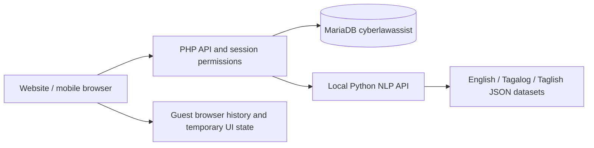
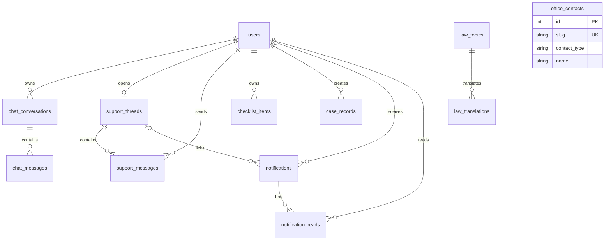

# CyberLawAssist database plan

Status: implemented through the PHP API and MariaDB. See the root README for startup and the localhost administrator setup. The sections below record the database design. Frontend acceptance is recorded from the project owner; chatbot accuracy and content review belong to the group. This document covers the database phase.

## 1. Basis and target

Basis: `polishing current UI design.txt`, `System Plan for Attorney.docx` / `.md`, `Attorney_Law_App_UIUX_Plan.docx`, the later approved Guest/User/Admin screens, and the current PHP/JavaScript/Python files. Later project decisions define the account roles, live support, physical intake, notifications, reports, and offline multilingual chatbot. Older no-login descriptions do not describe the implemented screens.

One database: **cyberlawassist**. The installed XAMPP database binary reports **MariaDB 10.4.32**. `schema.sql` targets that version with InnoDB, explicit foreign keys, and `utf8mb4_unicode_ci` for English, Tagalog, and Taglish text. Use full foreign-key constraints rather than shorthand `REFERENCES` column declarations. See [MariaDB CREATE TABLE](https://mariadb.com/docs/server/server-usage/tables/create-table) and [JSON data type](https://mariadb.com/docs/server/reference/data-types/string-data-types/json).

The note's Guest/User/Admin feature counts describe access to features. Shared features use the same tables with different permissions. This plan has **12 tables**.

## 2. Data location

| Data | Target location | Ownership |
|---|---|---|
| Guest AI conversations, titles, pins, read markers, language | Browser | This guest on this device; no guest account rows |
| Signed-in AI conversations and checklist | MariaDB | The authenticated account, including an admin's own AI conversations |
| Profile, password hash, role, preferences | MariaDB | Account owner; safe directory fields also available to admin |
| Live support | MariaDB | Registered user and office administrators |
| Physical intake and reports | MariaDB | Office administrators |
| Notifications and alerts | MariaDB; guest read markers remain local | Intended recipient or audience |
| Law content, translations, office/reporting contacts | MariaDB | Public read access to published records |
| AI knowledge base: 1,023 Q&A pairs per language | Existing Python JSON files | Loaded locally by the NLP engine |
| In-progress decision guide, selected tab/report period | Browser session | Temporary UI state |
| Printed documents and exported Word documents | Generated from authorized data | No separate export/print table |

Account history in MariaDB is the target behavior for the database phase. Current browser history is not uploaded automatically. Guest incident text stays out of SQL. Live support and physical intake are deliberate submissions to the office and remain separate from AI conversations.

PHP handles identity, permissions, storage, and reports. Python handles text matching and prepared answers. Python does not require database credentials. Both services run locally without a cloud AI account.

## 3. Tables and fields

The complete field types, indexes, unique rules, and foreign keys are in `schema.sql`.

| # | Table | Purpose | Main fields |
|---|---|---|---|
| 1 | `users` | User/Admin accounts, profile, preferences | `id`, `name`, unique `email`, `phone`, unique nullable `admin_number`, `policy_version`, `policy_accepted_at`, `password_hash`, `role`, `status`, `ui_language`, `chat_language`, preference flags, timestamps |
| 2 | `chat_conversations` | AI history: title, pin, ownership, context | `id`, `user_id`, `title`, `is_pinned`, `last_topic`, timestamps |
| 3 | `chat_messages` | User prompts and actual AI replies | `id`, `conversation_id`, `request_key`, `sender`, `body`, `language`, `delivery_status`, `response_meta`, timestamps |
| 4 | `support_threads` | One ongoing office conversation per registered user | `id`, unique `user_id`, timestamps |
| 5 | `support_messages` | Messages between registered users and administrators | `id`, `thread_id`, `sender_user_id`, `sender_role`, `request_key`, `body`, `created_at` |
| 6 | `checklist_items` | Personal checklist and completion state | `id`, `user_id`, `label`, `is_completed`, `sort_order`, timestamps |
| 7 | `case_records` | Full physical intake and report source | `id`, unique `reference`, `visitor_name`, `contact_number`, `concern_type`, `visit_date`, `assigned_staff`, `status`, `factual_notes`, `is_legacy`, `created_by`, timestamps |
| 8 | `notifications` | General notices, targeted replies, admin/user alerts | `id`, optional `recipient_user_id`, `audience`, `kind`, English/Tagalog title and body, `action_tab`, optional `support_thread_id`, `created_at` |
| 9 | `notification_reads` | Per-account read/unread state | Composite key `notification_id` + `user_id`, `read_at` |
| 10 | `law_topics` | Shared identity and legal references for law-guide topics | `id`, unique `slug`, `law_reference`, `section_reference`, `source_urls`, `sort_order`, `is_published`, timestamps |
| 11 | `law_translations` | English, Tagalog, Taglish law content | Composite key `law_topic_id` + `language`, `title`, `summary`, `legal_text`, `penalties`, `fines`, `evidence_guidance`, `next_steps` |
| 12 | `office_contacts` | Office details and official reporting contacts | `id`, unique `slug`, `contact_type`, `name`, `address`, `phone`, `website_url`, `source_url`, `sort_order`, `is_active`, `updated_at` |

### IDs and timestamps

- Keep the existing 32-character account IDs from `auth.php` (`bin2hex(random_bytes(16))`). References to users use the same ASCII field type and collation.
- Other record IDs use auto-increment integers. Browser request keys remain separate from server record IDs.
- Store event timestamps in UTC. Set the PHP database connection time zone to `+00:00`; show dates/times in Asia/Manila.
- `visit_date` is the office's calendar date, not a UTC timestamp conversion.
- Keep email normalized with trim/lowercase and enforce the unique index. Keep password hashes compatible with PHP `password_verify()`.
- Account roles are `user` and `admin`. A guest is an unauthenticated visitor, not a placeholder row shared by every guest.

### AI conversation and retry rules

1. Create a conversation on the first submitted message, not when an empty New chat is opened.
2. Store its user prompt once with `delivery_status=pending` and a stable request key.
3. PHP commits that prompt before calling Python; do not keep a database transaction open while waiting for the AI.
4. On a reply, a short transaction inserts the assistant message and marks the prompt `sent`. Both messages use the same request key. Store the returned topic/context and metadata, including source references and suggestions.
5. Unique `(conversation_id, request_key, sender)` prevents duplicate prompts or assistant replies on retries. If already complete, return the stored reply. An in-flight request returns a pending state; retry after the configured request timeout can recover an abandoned pending request. Python calls have no database side effects.
6. On an AI timeout or service failure, mark the existing prompt `failed`, without adding a fabricated reply. Retry reuses that prompt's request key.
7. Pair replies with their matching prompt when rendering. Requests that complete out of order must not be displayed beside the wrong question.
8. Update conversation timestamps in the same transaction as the message change. Treat renaming separately so it cannot overwrite a newer message.
9. Delete only a conversation owned by the current account; its messages cascade. A late AI reply checks that the conversation still exists and must never recreate a deleted conversation.
10. `sender=user` means the human participant, including an administrator using their own AI chatbot. It is separate from the account's authorization role.

`response_meta` is JSON holding `{topic, intent_id, kind, match_score, sources, suggestions}` from the trusted local NLP response. The PHP endpoint accepts the human prompt and request key, not a client-written assistant answer. Similarity scores retain their current retrieval meaning.

### Live support

- One thread per registered account matches the current interface. Admin opens the thread from the inbox and replies to that user.
- The sender ID and role come from the authenticated session/database, never from editable profile email or request-supplied role.
- PHP checks that a user owns the thread or is an administrator before any read/write. Guests cannot list, create, or reply to threads.
- A stable client request key prevents duplicate messages. Update the thread timestamp, insert the message, and create its targeted notification in one transaction.
- Derive Awaiting reply/Replied from the last actual message's sender; do not maintain a second potentially inconsistent status column.
- A staff reply creates a notification targeted to that user. An incoming user message can create an admin-audience notification. Notification text should identify the action without copying private chat text into a broadcast.
- The first PHP implementation can poll for messages after the latest message ID; the schema does not require WebSockets.

### Checklist

- Each registered user/admin owns the items shown in their checklist. Seed the current four default items once during account setup, in the same transaction as account creation.
- Store added items and completion state against the account ID.
- Print/export reads only the current owner's checklist and preserves the current checklist-only print layout.

### Intake and reports

- Every new intake requires a visitor name, valid visit date, supported concern/status, and authenticated admin creator. Keep optional contact/staff/notes fields optional, as in the current form.
- A walk-in visitor does not need an account. `created_by` records the administrator, not the visitor.
- `assigned_staff` remains a name because the current input is free text; do not invent a staff-account link.
- Generate the reference in a transaction: insert the record, obtain its auto-increment ID, assign `PAO-{current Manila year}-{ID padded to at least 3 digits}`, then commit. This uses a global sequence and avoids unsafe `MAX()+1` races. The stored reference remains unchanged when the visit date is edited.
- `reference` is temporarily NULL inside that transaction; PHP must assign it before committing or roll back. Existing genuine references can be preserved during an explicit import.
- Legacy records may have NULL visitor/date; flag them `is_legacy=1`, display Not recorded, and exclude unknown visit dates from reports. Do not fill missing data with today's date.
- The current dashboard and report pages query `case_records`. There is no separate reports table.
- Week: Monday to Sunday, seven daily buckets. Month: all calendar days, including 28/29/30/31. Year: twelve month buckets. Fill empty buckets with zero.
- Filter by an inclusive start date and an exclusive end date. Summary cards, charts, and Word reports use the same authorized dataset and period.
- Current Completed/Referred counts reflect each record's present status within its visit-date period. They do not measure the date of resolution; that would require a different field/feature.
- UI status mapping: For review -> `for_review`; In progress -> `in_progress`; Referred -> `referred`; Completed -> `completed`.
- Concern mapping: Online harassment -> `online_harassment`; Account access concern -> `account_access`; Online fraud inquiry -> `online_fraud`; Identity theft -> `identity_theft`; Other -> `other`.

### Notifications and alerts

- A notification belongs either to one recipient (`recipient_user_id` set) or to a role audience (`recipient_user_id` NULL).
- For a signed-in account, PHP selects its own recipient rows plus broadcasts for `all` and its actual database role. Personal recipient rows are never included just because their audience matches a role.
- Guest reads return only public broadcasts for `guest`/`all`, with kind `notification`. Guest read markers stay local.
- An admin does not automatically receive another account's personal notifications.
- `notification_reads` supports Mark read/Mark all read per account without marking other accounts' notices as read. Insert read markers only after checking notice visibility.
- Use `kind=alert` for the existing User/Admin Alerts tab. Office case alerts have admin audience.
- Use stored English/Tagalog content for the current interface languages; fall back to English if a Tagalog value is absent. Taglish remains available for bot replies and law translations.
- Whitelist `action_tab` values in PHP/JavaScript; it is a local tab identifier, not an arbitrary redirect URL.

## 4. Relationships

`office_contacts` is independent shared public content. No separate guest/user/admin databases, chatbot-history table, suggestions table, reports table, or printing table are needed for these screens.

## 5. Permissions PHP must enforce

| Feature/data | Guest | User | Admin |
|---|---|---|---|
| Published law guide, office contacts | Read | Read | Read |
| Offline AI replies | Ephemeral server processing; local history | Own conversations | Own conversations |
| Rename/pin/delete AI history | Own browser | Own account | Own account |
| Profile/preferences | Local language only | Own account | Own account |
| Checklist, print/export checklist | No access | Own items | Own items |
| Live support | No access | Own thread | All registered-user threads; reply as self |
| Notifications | Public notices, local read markers | Visible notices/own read markers | Visible notices/own read markers |
| Alerts | No access | Own/user/all notices | Own/admin/all notices |
| Physical intake, case records, reports | No access | No access | Read/create office records; export reports |
| Registered-user directory | No access | No access | Safe profile fields, no password hashes |

Admin permissions do not include browsing users' private AI histories. Public signup always creates a `user`, regardless of submitted role values. Only authenticated administrators can create `admin` accounts through Users -> Create administrator; the creating administrator stays signed in. Each account can open only its assigned workspace, on desktop and mobile; signing into another account requires logging out. There are no seeded default passwords. Admins can disable Users or permanently delete a User after confirming DELETE and their administrator password. Deletion removes the User's personal chat/checklist/support/notification records in a transaction. Accounts referenced as creators of office case records cannot be deleted; disable them instead. Admin accounts have unique admin numbers and use admin-number/password login.

Use PHP sessions as already started in `auth.php`, PDO prepared statements, server-side ownership checks, CSRF validation for authenticated mutations, and input limits matching the UI. Validate the current account's role/status from SQL on protected requests. Browser role pages and localStorage are presentation state, not authentication. Keep PHP database credentials in server-only configuration outside the public web root; do not use the database root account for the application.

## 6. Current storage -> target

| Current source | Target | Migration rule |
|---|---|---|
| `assets/php/private/users.json` | `users` | Preserve IDs, names, normalized email, phone, existing password hashes, role, created date. Resolve duplicate email/ID conflicts explicitly; never discard an account silently. |
| `cla-user-profile`, `cla-admin-profile` | `users` profile | Session account determines owner. A cached email does not prove account ownership. |
| `cla-{role}-language`, `cla-{role}-chat-language`, settings | `users` preference columns | Guest preferences stay local; signed-in preferences use actual account ID. Email updates remains a preference, not proof an email delivery service exists. |
| `cla-{role}-chat-state` / legacy chat | Conversation/message tables for signed-in accounts | Existing storage is role-wide, not account-owned. Do not import it automatically into whoever logs in next. An explicit import must identify its owner, preview the content, and use stable keys to avoid duplication. Guest history stays local. |
| `cla-support-threads` | Support thread/message tables | Replace editable browser email identities with real account IDs. Existing local system/preview replies are not genuine staff messages and are not imported as such. |
| `cla-{role}-checks` | `checklist_items` | Same ownership issue: import only explicitly assigned real items; initialize defaults once for new accounts. |
| `cla-admin-cases` | `case_records` | Admin-controlled import of real intake only. Skip unchanged seeded demo arrays; retain truthful missing fields on genuine legacy records. Record the importing admin as creator for legacy entries without inventing an original staff identity. |
| `cla-{role}-notices` | `notifications`, `notification_reads` | Seed agreed informational notices separately; browser preview read flags are not shared account history. |
| `cla-user-directory` | Query `users` | Do not treat this client cache as an account database. |
| Static Law/About copy | Published law rows/translations and office contacts | Copy the agreed content; seed only actual approved values. |
| `cla-step`, `cla-choice`, `cla-safety`, `cla-evidence`, report selections | Browser session | Temporary navigation/form choices; no database migration. |
| Python `qa_en.json`, `qa_tl.json`, `qa_taglish.json` | Existing files | No duplicate Q&A import into SQL. |

Do not erase localStorage after a failed or partial import. Confirm committed destination records and idempotent mappings before clearing an explicitly imported source. Change future account caches to include the account ID rather than just the role.

## 7. PHP implementation order

1. Import `schema.sql` into a fresh database, create the application's restricted database user, and configure a PDO connection using UTF-8 and UTC session timestamps.
2. Move the existing `auth.php` actions from JSON to SQL while preserving the existing form/API contract (`register`, `login`, `me`, `logout`). Migrate genuine accounts. Restrict public registration to Users and provide admin-only administrator creation. Route signed-in accounts to their assigned workspace.
3. Connect profile/preferences and protected role access. Replace the browser-based Users directory with safe SQL reads.
4. Connect conversation/history CRUD and the local Python AI request. Keep Guest AI requests ephemeral. PHP proxies to `127.0.0.1:8001`, so the browser does not need to reach the Python port directly.
5. Connect personal checklist actions and existing print/export behavior.
6. Connect registered-user support inbox/messages, targeted notifications, and read markers.
7. Connect physical intake, record details, report queries, and matching formatted Word export.
8. Serve agreed published law translations and contacts; replace preview wording with accurate storage descriptions for each role.

Suggested endpoint groups: keep `auth.php`; add `profile.php`, `chat.php`, `ai.php` (ephemeral guest requests), `support.php`, `checklist.php`, `notifications.php`, `cases.php`, `reports.php`, `users.php`, and `content.php`. These are implementation groups, not files created by this plan. Every protected group checks the session independently.

## 8. Handoff status

`schema.sql` is an installation creation script. `setup.php` installs/seeds it, and `migrate.php` handles the additive implementation columns (session invalidation, request deduplication, and intake revisions). It is not a replacement for an upgrade migration. It contains no DROP/TRUNCATE statements, no changes to existing tables, and no sample personal data. It has been installed on the project computer during backend implementation. A future import should target a fresh database; partially imported or existing databases need explicit migrations rather than rerunning the script blindly.

New User registration records the accepted policy version and UTC acknowledgement timestamp. Older accounts and managed administrator accounts retain NULL when no acknowledgement was recorded. Public-file browser caching excludes all account/API responses and protected workspace HTML.
